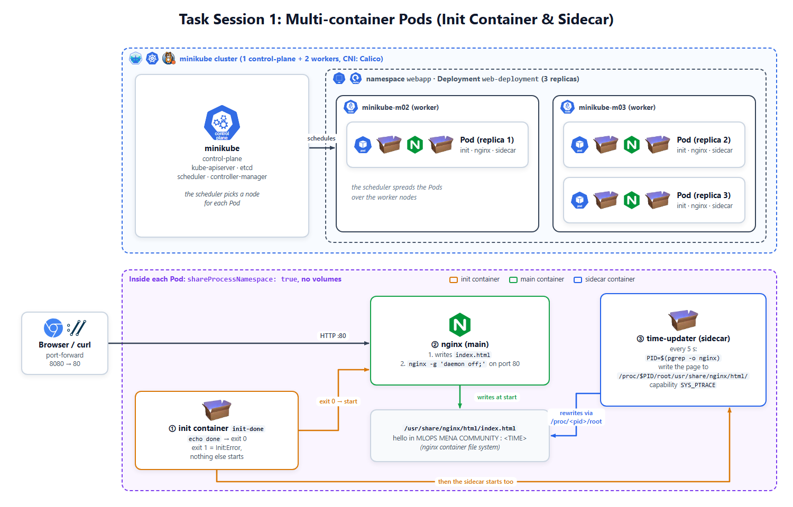
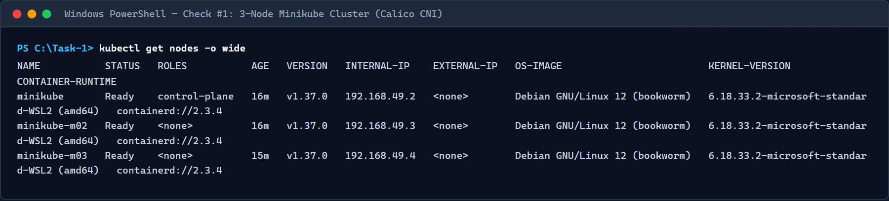
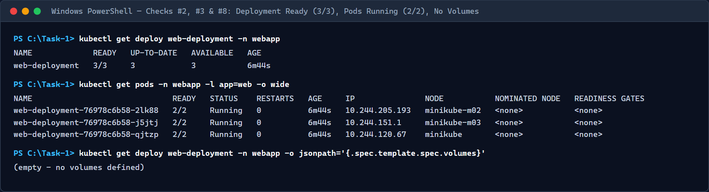
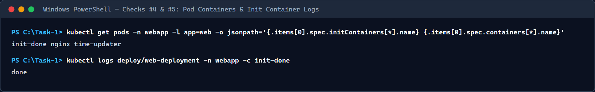
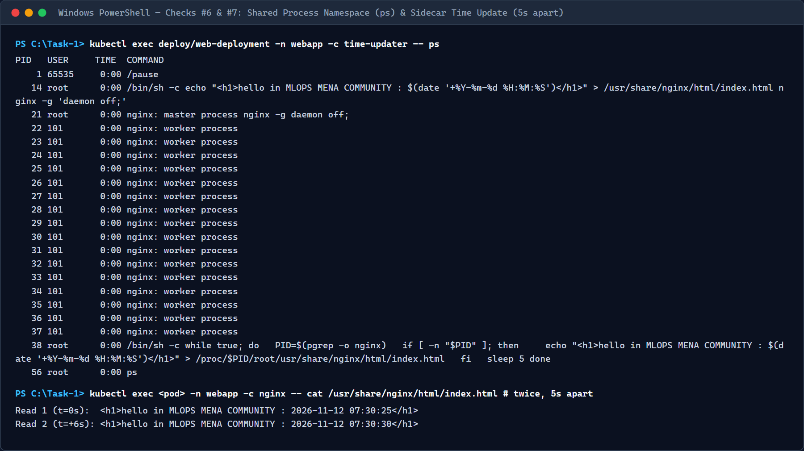
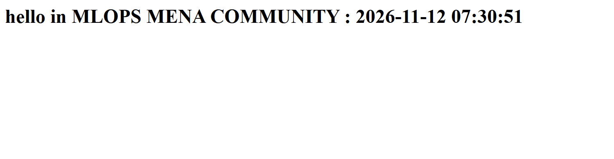
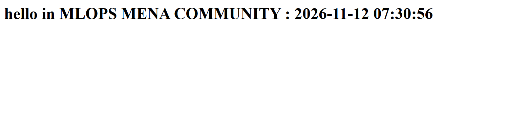
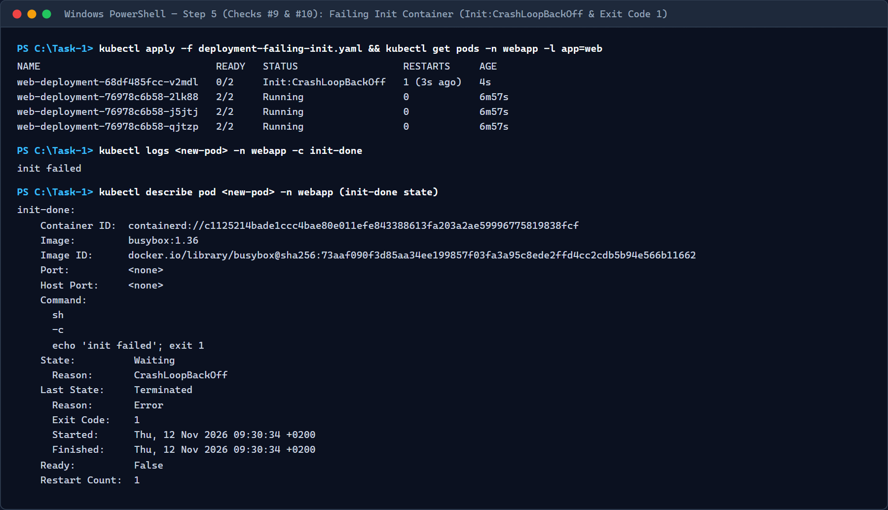
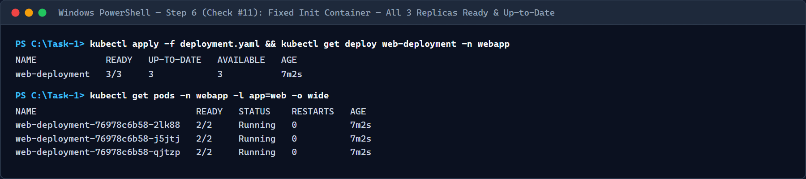

# Task 1: Multi-Container Pods (Init Container & Sidecar Without Volumes)

## Overview

This folder contains the manifests, verification scripts, terminal evidence, screenshots, and technical documentation for **Session 1 (Task 1)** of the MLOps MENA Community Kubernetes Course.

We deploy a 3-replica `nginx` application (`web-deployment`) inside the `webapp` namespace on a 3-node Minikube cluster with the **Calico** CNI plugin. Each Pod serves a live page showing the current timestamp:

```text
hello in MLOPS MENA COMMUNITY : <YYYY-MM-DD HH:MM:SS>
```

Instead of mounting a shared volume, each Pod enables **`shareProcessNamespace: true`** so the `time-updater` sidecar container can locate the running `nginx` master process (`pgrep -o nginx`) and overwrite `/proc/$PID/root/usr/share/nginx/html/index.html` every 5 seconds using the `SYS_PTRACE` Linux capability.

> **Full Deep-Dive Guide:** Open [`docs/index.html`](docs/index.html) in any browser for an interactive, line-by-line conceptual and architectural walkthrough.

---

## Architecture Diagram



| Container | Type | Image | Role |
|-----------|------|-------|------|
| `init-done` | Init Container | `busybox:1.36` | Prints `done` and exits (`0`). Blocks app containers until completion. |
| `nginx` | Main Container | `nginx:1.27` | Writes initial `index.html` with timestamp and serves port `80` in the foreground. |
| `time-updater` | Sidecar Container | `busybox:1.36` | Rewrites `/proc/$PID/root/usr/share/nginx/html/index.html` every 5 seconds (`SYS_PTRACE`). |

---

## Folder Structure

```text
Task-1/
├── namespace.yaml                # Namespace: webapp
├── deployment.yaml               # Working 3-replica multi-container Deployment (no volumes)
├── deployment-failing-init.yaml  # Step 5 Deployment with failing init container (exit 1)
├── README.md                     # Submission documentation & verification results
├── docs/
│   ├── index.html                # Self-contained deep-dive HTML guide
│   └── architecture.png          # Architecture diagram for HTML docs
├── images/
│   └── architecture.png          # Architecture diagram for README
├── scripts/
│   ├── verify.ps1                # End-to-end automated verification & screenshot script
│   └── screenshots.py            # Headless Microsoft Edge Playwright screenshot utility
├── tests/
│   └── test_task1.py             # Automated Unit, Linear, and Regression pytest suite (12 tests)
├── evidence/                     # Raw CLI verification logs (Checks 1-11 + pytest output)
└── screenshots/                  # Terminal & browser verification screenshots
```

---

## Manifests Summary

### 1. `namespace.yaml`
Creates the `webapp` namespace.

### 2. `deployment.yaml`
Creates `web-deployment` in namespace `webapp` with:
- `replicas: 3`
- Selector & Pod template label: `app: web`
- `shareProcessNamespace: true` and **no volumes** (`spec.template.spec.volumes` is absent)
- Init container `init-done` (`busybox:1.36`) running `["sh", "-c", "echo done"]`
- Main container `nginx` (`nginx:1.27`, port `80`) writing the initial greeting and starting `nginx -g 'daemon off;'`
- Sidecar container `time-updater` (`busybox:1.36`) with `securityContext.capabilities.add: ["SYS_PTRACE"]` updating `/proc/$PID/root/usr/share/nginx/html/index.html` every 5 seconds

### 3. `deployment-failing-init.yaml`
Used in **Step 5** to test how Kubernetes handles a broken init container during a rolling update by setting `init-done`'s command to `["sh", "-c", "echo 'init failed'; exit 1"]`.

---

## Commands Executed

### Step 1: Start the 3-Node Minikube Cluster with Calico
```bash
minikube start --nodes 3 --cni=calico --cpus 2 --memory 2200
kubectl get nodes -o wide
```

### Step 2 & 3: Create Namespace and Deploy Working Application
```bash
kubectl apply -f namespace.yaml
kubectl apply -f deployment.yaml
kubectl rollout status deploy/web-deployment -n webapp
kubectl get pods -n webapp -l app=web -o wide
```

### Step 4: Port-Forward and Verify Dynamic Time Updates
```bash
kubectl port-forward -n webapp deploy/web-deployment 8080:80
# Open http://localhost:8080 and refresh after 5 seconds
```

### Step 5: Trigger Init Container Failure (`exit 1`)
```bash
kubectl apply -f deployment-failing-init.yaml
kubectl get pods -n webapp -l app=web
kubectl logs <new-pod> -n webapp -c init-done
kubectl describe pod <new-pod> -n webapp
```

### Step 6: Restore Working Deployment
```bash
kubectl apply -f deployment.yaml
kubectl rollout status deploy/web-deployment -n webapp
kubectl get deploy web-deployment -n webapp
```

---

## Step 5 Questions & Answers (Failing Init Container Analysis)

1. **Which status does the new Pod show?**
   - The new surge Pod immediately enters `Init:Error` (`READY 0/2`) and then transitions to **`Init:CrashLoopBackOff`** (`READY 0/2`) as the kubelet repeatedly retries the failing `init-done` container with exponential backoff. Running `kubectl describe pod <new-pod> -n webapp` shows `Exit Code: 1` and `kubectl logs <new-pod> -n webapp -c init-done` outputs `init failed`.

2. **Do `nginx` and `time-updater` start?**
   - **No.** Kubernetes guarantees that all `initContainers` run sequentially to completion (`Exit Code: 0`) before any regular container in `spec.containers` is started. Because `init-done` exits with code `1`, `nginx` and `time-updater` stay in `Waiting (Reason: PodInitializing)` and never start inside the broken Pod.

3. **Is the page still reachable, and why?**
   - **Yes, the page remains completely reachable and keeps updating every 5 seconds.**
   - **Why:** `web-deployment` uses the default `RollingUpdate` strategy (`maxUnavailable: 25%`, `maxSurge: 25%`). For 3 replicas, `maxUnavailable` rounds down to `0` (meaning Kubernetes cannot terminate any of the 3 existing Ready Pods until a replacement Pod is Ready), and `maxSurge` rounds up to `1` (allowing 1 extra surge Pod to be created). Because the new surge Pod never reaches `Ready`, the rollout pauses safely while the **3 original Pods stay `2/2 Running`** and continue serving traffic.

---

## 11 Verification Checks Summary

| # | Check | Command | Expected Result | Result |
|---|-------|---------|-----------------|--------|
| 1 | 3 nodes | `kubectl get nodes` | `minikube`, `minikube-m02`, `minikube-m03` are `Ready` | **PASS** |
| 2 | Deployment ready | `kubectl get deploy web-deployment -n webapp` | `READY 3/3` | **PASS** |
| 3 | Pods running | `kubectl get pods -n webapp -l app=web` | 3 Pods, each `2/2 Running` | **PASS** |
| 4 | Containers | `kubectl get pods -n webapp -l app=web -o jsonpath='{.items[0].spec.initContainers[*].name} {.items[0].spec.containers[*].name}'` | `init-done nginx time-updater` | **PASS** |
| 5 | Init succeeded | `kubectl logs deploy/web-deployment -n webapp -c init-done` | `done` | **PASS** |
| 6 | Sidecar sees nginx | `kubectl exec deploy/web-deployment -n webapp -c time-updater -- ps` | `nginx: master process` in the list | **PASS** |
| 7 | Time updates | `kubectl exec deploy/web-deployment -n webapp -c nginx -- cat /usr/share/nginx/html/index.html` (twice, 5 s apart) | `hello in MLOPS MENA COMMUNITY : ...` with a new time | **PASS** |
| 8 | No volumes | `kubectl get deploy web-deployment -n webapp -o jsonpath='{.spec.template.spec.volumes}'` | Empty | **PASS** |
| 9 | Failing init (Step 5) | `kubectl get pods -n webapp -l app=web` | New Pod `Init:Error` -> `Init:CrashLoopBackOff`, `READY 0/2`; 3 old Pods stay `2/2 Running` | **PASS** |
| 10 | Init error details (Step 5) | `kubectl describe pod <new-pod> -n webapp` | `init-done`: `Exit Code: 1` | **PASS** |
| 11 | Fixed (Step 6) | `kubectl get deploy web-deployment -n webapp` | `READY 3/3`, `UP-TO-DATE 3` | **PASS** |

---

## Automated Test Suite (Unit, Linear, and Regression)

Run the full automated test suite against the live 3-node Minikube cluster:

```bash
pytest Task-1/tests/test_task1.py -v
```

| Suite Category | Class | Tests | Result |
|---|---|---|---|
| **Unit Tests** | `TestUnitManifestsAndDocs` | Validates `namespace.yaml`, `deployment.yaml` schema/labels/capabilities/no-volumes, exact single-line diff for `deployment-failing-init.yaml`, and clean human-written files | **4 / 4 PASSED** |
| **Linear Lifecycle Tests** | `TestLinearClusterLifecycle` | Executes Steps 1 → 6 in strict sequence on the live cluster: 3 Ready nodes + Calico CNI, working deploy (`3/3`), `init-done` logs, `ps` shared PID check, 5s timestamp delta, Step 5 `Init:CrashLoopBackOff` (`Exit Code: 1`) + live HTTP `200 OK` zero-downtime proof, and Step 6 rollout recovery | **4 / 4 PASSED** |
| **Regression Tests** | `TestRegressionInvariants` | Verifies zero lingering failed pods, `0` restarts on `time-updater` sidecars across all 3 replicas, label selector anti-drift (`app=web`), and non-empty PNG screenshots | **4 / 4 PASSED** |

---

## Verification Screenshots

### 1. Cluster Nodes (`minikube`, `minikube-m02`, `minikube-m03` Ready)


### 2. Deployment & 3 Replicas Running (`2/2 Running`)


### 3. Container Names, Init Container Logs (`done`), and Zero Volumes Check


### 4. Shared Process Namespace (`ps`) & 5-Second HTML Timestamp Updates


### 5. Web Browser Output — Initial Timestamp


### 6. Web Browser Output — Refreshed After 5 Seconds (Updated Timestamp)


### 7. Step 5 — Failing Init Container (`Init:CrashLoopBackOff`, `Exit Code: 1`, 3 Old Pods Running)


### 8. Step 6 — Rollout Fixed (`3/3 Ready`, `UP-TO-DATE 3`)

